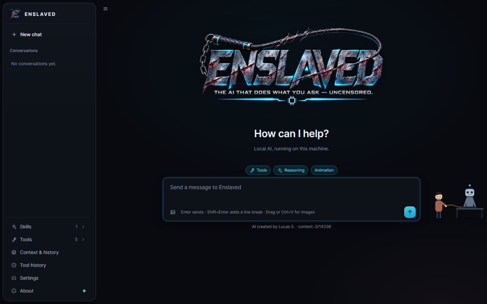
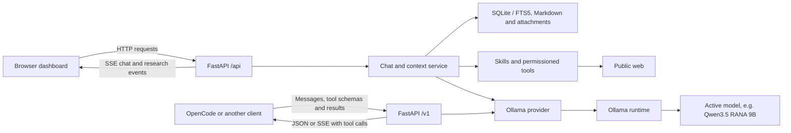

<p align="center">
  
</p>

# Enslaved — Local AI Assistant & OpenAI-Compatible Inference Stack

[Read in Brazilian Portuguese](README.pt-BR.md)

Enslaved is a personal AI assistant that runs models on your machine through Ollama. Its browser dashboard provides streaming chat, local conversation history, permissioned tools, and web research. A separate loopback API lets OpenAI-compatible editors and CLI clients use the same local model.



The screenshot shows the running app in English with a fresh local database.

## Capabilities

- Stream chat responses and stop generation in the dashboard. Attach images when the selected model supports vision.
- Manage conversations and their context locally. Inspect context usage, compact long threads, and export transcripts as Markdown.
- Load project skills and invoke built-in tools for diagnostics, text analysis, allowed file reads, and public-web retrieval.
- Run Quick, Deep, or Extended web research with evidence and source links.
- Connect external clients through authenticated, OpenAI-compatible chat completions and model listing.

## Architecture



| Layer | Implementation |
| --- | --- |
| Backend | Python 3.12+, FastAPI, Uvicorn, Pydantic, HTTPX, and YAML configuration |
| Frontend | HTML, CSS, and vanilla JavaScript served by FastAPI, with marked and DOMPurify for Markdown rendering |
| Inference | Ollama's native API, with model-specific settings and a simulated provider for development |
| Persistence | SQLite with FTS5, Markdown transcript exports, local attachments, and JSONL tool audit events |
| Streaming | Server-Sent Events (SSE) for dashboard chat, research progress, and API completions |

### Chat, skills, and local memory

Chat combines the active conversation, configured directives, explicitly selected skills, and available tools. Skills are described by `SKILL.md` files under configured directories. The [included example](skills/hello-enslaved/SKILL.md) demonstrates the format.

SQLite stores conversations and context summaries. Markdown exports and image attachments also live under `data/` by default. Repack compacts long conversations and preserves recent turns. Relevant history can be recovered within the same conversation. Each conversation keeps its own context.

### Web research

Quick research handles lightweight searches. Deep and Extended modes gather public-web evidence within configured request, time, and byte limits. Reports can include source links and an evidence ledger. Web access is governed by the `net.fetch` policy. Research depth leaves that policy in effect. DuckDuckGo is the default search provider. To use Brave Search, set `chat.search_provider: brave` and supply `ENSLAVED_SEARCH_API_KEY` locally.

### Security and permissions

- The backend defaults to loopback. Dashboard routes check request hosts and browser origins. The dashboard has no user login or HTTPS.
- The tool policy uses `allow`, `ask`, and `deny`. File reads and outbound web access default to `ask`. Reads are confined to configured roots. Web fetches validate public addresses and revalidate redirects.
- The `/v1` API requires a bearer key and stays on loopback even when the dashboard is on the LAN. The key authorizes inference only. Keys are shown in full at creation and stored as hashes with a display prefix.
- Local inference keeps model requests on your machine with the default Ollama URL. Approved web research sends search queries or HTTP requests to external services.

> [!CAUTION]
> `start.bat` opens the dashboard to your local network. Devices that can reach it can access chats, approve tools, or delete data. Use the loopback command below for single-machine use.

## Local inference and models

The default model is **Qwen3.5 RANA 9B Q6_K** via Ollama, using the tag `abliterant/qwen3.5-rana:9b-q6_K`. Keeping inference local gives the operator control over model selection, generation settings, and data storage.

| Model run locally | Recorded use |
| --- | --- |
| `abliterant/qwen3.5-rana:9b-q6_K` | Current default. Exercised with the Local API and OpenCode. |
| `qwen3.5:4b` | Earlier development model. Validated with real Ollama inference and streaming. |
| `hf.co/bartowski/Qwen_Qwen3.5-9B-GGUF:Q6_K` | Earlier 9B configuration. Tested with real inference, tool calling, and conversation continuity. |

This table covers recorded local executions. Model-card comparisons are desk research. External development assistants belong to the software development workflow. Future model and tuning candidates remain roadmap work.

**We are actively working on code-focused fine-tuning and iterative improvement of the local model for personal AI-assisted software development.** The work targets code quality, instruction following, and tool use. Fine-tuning changes model weights. Prompt design, context calibration, and inference settings are separate methods for improving behavior.

Models are obtained separately under their upstream terms. See the [RANA registry entry](https://ollama.com/abliterant/qwen3.5-rana), [Qwen3.5 registry entry](https://ollama.com/library/qwen3.5), and [9B GGUF model card](https://huggingface.co/bartowski/Qwen_Qwen3.5-9B-GGUF).

### Development and validation hardware

| Component | Reference machine |
| --- | --- |
| OS | Windows |
| GPU | NVIDIA GeForce RTX 3080 Ti with 12 GB VRAM |
| CPU | Intel Core i7-12700KF |
| RAM | 32 GB |

This is the consumer-hardware reference used for development and validation. Model, context, and concurrent workload determine actual resource use.

## OpenAI-compatible API

Enable **Settings → Local API** and create a key for each client. Keep the key in the client's environment or secret store. The base URL is `http://127.0.0.1:8000/v1` on the default port.

| Endpoint | Function |
| --- | --- |
| `GET /v1/models` | Returns the active model identifier |
| `POST /v1/chat/completions` | Chat completions via JSON or SSE, with client-supplied tool schemas when supported by the model |

The API is stateless. Clients send their own messages and tool outputs. They have no access to dashboard chats, skills, or memory through these endpoints. OpenCode sends messages and tool schemas to Enslaved, which forwards the turn to Ollama and the active RANA model. Enslaved returns tool calls to OpenCode. OpenCode executes them under its own permissions and sends the results in a later request.

| Setting | Current default |
| --- | --- |
| RANA context window | 16,384 tokens |
| RANA completion budget | 2,048 tokens |
| RANA input budget with the default output reservation | 14,336 tokens before accounting for request estimation and template overhead |
| Active Local API keys | Up to 5 |
| Simultaneous Local API generations | 2, with a 30-second queue timeout |

Enslaved rejects requests that exceed the active model's configured budgets. Completion, errors, and client disconnects release the generation slot. The token figures apply to the current RANA profile. The key and concurrency controls belong to the Local API.

### OpenCode setup

1. In **Settings → Local API**, enable the API, create an OpenCode key, and copy the matching OpenCode configuration example into your OpenCode project's `opencode.json`. The dashboard offers both the V2 format and the V1-compatible format validated with OpenCode 2.2.5. Use one format and keep `{env:ENSLAVED_API_KEY}` in the configuration.
2. Set the key in the same PowerShell session that will start OpenCode. The prompt keeps the key out of shell history.

   ```powershell
   $key = Read-Host "Enslaved API key" -AsSecureString
   $env:ENSLAVED_API_KEY = [System.Net.NetworkCredential]::new('', $key).Password
   opencode
   ```

3. Select the Enslaved model via `/models`. Keep the context and output limits generated by the dashboard so OpenCode can manage its history.

Prior OpenCode validation exercised tool calling, file creation, editing and reading, command execution, unit-test runs, streaming, and context control. The file and command operations ran in OpenCode. See [OpenCode model configuration](https://opencode.ai/docs/models/).

## Install and run on Windows

Requirements are Python 3.12 or newer, a modern browser, and [Ollama for Windows](https://docs.ollama.com/windows) for real inference. Check the model card for runtime compatibility and allow enough storage for the chosen model. The frontend needs no Node.js build.

From the root of a clean checkout, create a virtual environment and install the app:

```powershell
python --version
python -m venv .venv
.\.venv\Scripts\python.exe -m pip install -e .
```

Launch the Ollama Windows app or run `ollama serve` if the runtime is stopped. In another terminal, download the selected model separately and verify that it is available:

```powershell
ollama pull abliterant/qwen3.5-rana:9b-q6_K
ollama list
```

[config/settings.yaml](config/settings.yaml) contains the public defaults. For local overrides, optionally copy [.env.example](.env.example) to `.env` and uncomment the values you need. To use a different installed model, set `ENSLAVED_MODEL` or select a model in the dashboard and restart the backend. Process environment variables override `.env`. If `ENSLAVED_MODEL` is unset, the dashboard's saved model selection takes precedence over YAML.

Start Enslaved on loopback and open [the dashboard](http://127.0.0.1:8000/):

```powershell
.\.venv\Scripts\python.exe -m backend.main
```

Runtime storage is created automatically. English (`en-US`) is the default. Choose Brazilian Portuguese (`pt-BR`) under **Settings → Language**. To try chat without a model, set `$env:ENSLAVED_PROVIDER = 'simulated'` before starting the backend, then turn off **Tools** in the composer. Close the process with Ctrl+C.

## Testing

```powershell
.\.venv\Scripts\python.exe -m pip install -e ".[dev]"
.\.venv\Scripts\python.exe -m pytest -q
```

Most tests use simulated inference and mocked HTTP transports. Browser tests use Playwright with installed Google Chrome and write local artifacts under `docs/screenshots/`. Some Windows-specific checks are skipped on other platforms. The scripts in [scripts/](scripts/) are optional manual checks for real inference or benchmarking.

## Limitations and roadmap

- The documented deployment is a local Windows checkout. The dashboard assumes a trusted operator. This project has no external security audit.
- Compatibility covers the documented `/v1` endpoints and supported request fields. The active model determines vision and tool capability. The external completions endpoint currently handles text chat.
- Model responses and web reports can contain errors. Search provider availability and context limits affect what evidence a report can use.
- Planned work includes evaluating code-focused model variants, refining context and client interoperability, and exploring permissioned skill scripts and MCP integration.

## License and acknowledgments

Original Enslaved code is distributed under the [MIT License](LICENSE). Ollama, third-party dependencies, and model weights are governed by their respective licenses. The frontend uses system font fallbacks and ships no font files.

| Bundled component | Version | Notice |
| --- | --- | --- |
| marked | 15.0.12 | [MIT and original Markdown BSD notice](frontend/vendor/marked.LICENSE.md) |
| DOMPurify | 3.2.6 | [Apache-2.0 or MPL-2.0](frontend/vendor/purify.LICENSE) |

Enslaved builds on Ollama, the Qwen ecosystem, FastAPI, SQLite, and the other projects listed in [pyproject.toml](pyproject.toml).
