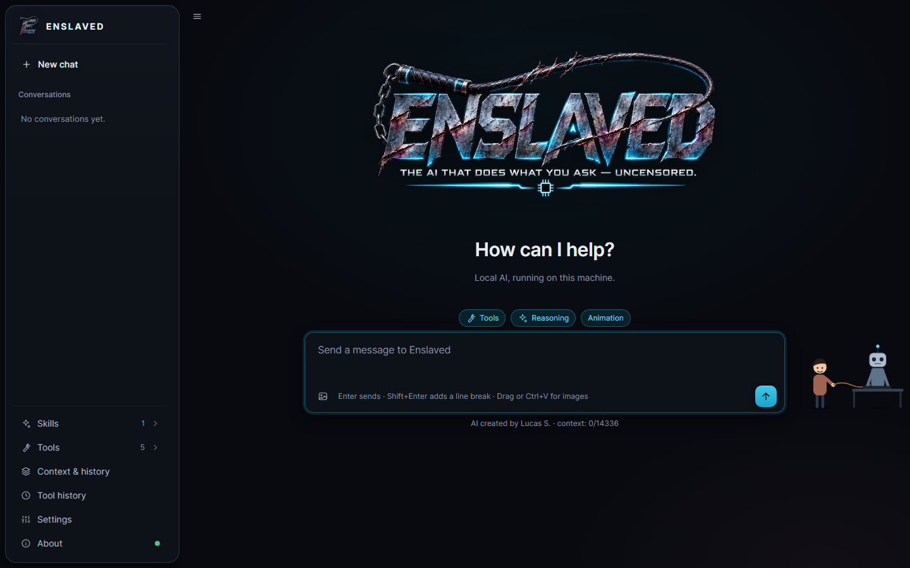
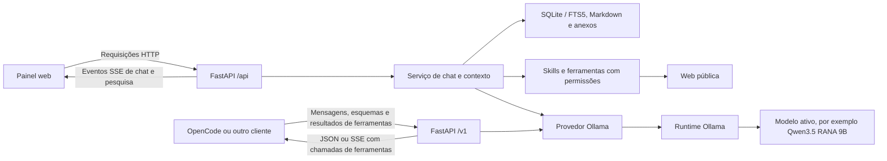

<p align="center">
  
</p>

# Enslaved — Assistente de IA local e stack de inferência compatível com OpenAI

[Versão principal em inglês](README.md)

Enslaved é um assistente pessoal de IA que executa modelos na sua máquina via Ollama. O painel web oferece chat com streaming, histórico local, ferramentas com controle de permissões e pesquisa na web. Uma API separada, restrita à interface de loopback, disponibiliza o mesmo modelo local para editores e clientes de linha de comando compatíveis com OpenAI.



A captura mostra o aplicativo em execução, em inglês, com um banco de dados local novo.

## Recursos

- Receba respostas em streaming e interrompa a geração pelo painel. Anexe imagens quando o modelo selecionado tiver suporte a visão.
- Gerencie conversas e seu contexto localmente. Inspecione o uso de contexto, compacte conversas longas e exporte transcrições em Markdown.
- Carregue skills do projeto e use ferramentas integradas para diagnóstico, análise de texto, leitura autorizada de arquivos e acesso à web pública.
- Pesquise na web nos modos Rápido, Profundo ou Estendido, com evidências e links para as fontes.
- Conecte clientes externos por endpoints autenticados de completions de chat e listagem de modelos compatíveis com OpenAI.

## Arquitetura



| Camada | Implementação |
| --- | --- |
| Backend | Python 3.12+, FastAPI, Uvicorn, Pydantic, HTTPX e configuração YAML |
| Frontend | HTML, CSS e JavaScript puro servidos pelo FastAPI, com marked e DOMPurify para renderizar Markdown |
| Inferência | API nativa do Ollama, com configuração por modelo e provedor simulado para desenvolvimento |
| Persistência | SQLite com FTS5, transcrições em Markdown, anexos locais e auditoria de ferramentas em JSONL |
| Streaming | Server-Sent Events (SSE) para chat do painel, andamento da pesquisa e completions da API |

### Chat, skills e memória local

O chat combina o contexto da conversa ativa, as diretrizes configuradas, as skills selecionadas e as ferramentas disponíveis. Arquivos `SKILL.md` descrevem as skills nos diretórios configurados. O [exemplo incluído](skills/hello-enslaved/SKILL.md) demonstra o formato.

O SQLite registra conversas e resumos de contexto. Por padrão, exportações Markdown e anexos de imagem também ficam em `data/`. O Repack compacta conversas longas e preserva os turnos recentes. Trechos relevantes do histórico podem ser recuperados na mesma conversa. Cada conversa mantém seu próprio contexto.

### Pesquisa na web

O modo Rápido atende buscas pontuais. Os modos Profundo e Estendido coletam evidências na web pública dentro dos limites de requisições, tempo e volume. Os relatórios podem incluir links para fontes e um registro das evidências. A política de `net.fetch` controla o acesso à web em todos os modos. DuckDuckGo é o provedor de busca padrão. Para usar Brave Search, configure `chat.search_provider: brave` e informe `ENSLAVED_SEARCH_API_KEY` localmente.

### Segurança e permissões

- O backend usa loopback por padrão. As rotas do painel verificam o host da requisição e a origem do navegador. O painel não tem autenticação de usuário nem HTTPS.
- A política de ferramentas usa os modos `allow`, `ask` e `deny`. A leitura de arquivos e o acesso à web pedem autorização por padrão. Leituras ficam restritas aos diretórios permitidos. O acesso à web valida endereços públicos e verifica cada redirecionamento.
- A API `/v1` exige uma chave bearer e permanece restrita ao loopback mesmo com o painel acessível na LAN. A chave autoriza apenas inferência. O valor completo é mostrado na criação e armazenado como hash com um prefixo para exibição.
- A inferência usa o Ollama na mesma máquina com o endereço padrão. Pesquisas autorizadas enviam consultas ou requisições HTTP a serviços externos.

> [!CAUTION]
> `start.bat` abre o painel na rede local. Dispositivos com acesso ao painel podem ler conversas, aprovar ferramentas ou excluir dados. Para uso em uma só máquina, execute o comando de loopback abaixo.

## Inferência local e modelos

O modelo padrão é **Qwen3.5 RANA 9B Q6_K**, via Ollama, com a tag `abliterant/qwen3.5-rana:9b-q6_K`. A inferência local permite controlar a seleção de modelos, os parâmetros de geração e o armazenamento dos dados.

| Modelo executado localmente | Uso registrado |
| --- | --- |
| `abliterant/qwen3.5-rana:9b-q6_K` | Padrão atual. Exercitado com a API Local e o OpenCode. |
| `qwen3.5:4b` | Modelo anterior de desenvolvimento. Validado com inferência real e streaming via Ollama. |
| `hf.co/bartowski/Qwen_Qwen3.5-9B-GGUF:Q6_K` | Configuração 9B anterior. Testada com inferência real, chamadas de ferramentas e continuidade de conversas. |

A tabela reúne as execuções locais registradas. Comparações baseadas em fichas de modelos são avaliações teóricas. Assistentes externos fazem parte do fluxo de desenvolvimento do software. Modelos candidatos e testes futuros fazem parte do roteiro.

**Estamos trabalhando em fine-tuning voltado a código e na melhoria iterativa do modelo local para desenvolvimento pessoal de software com auxílio de IA.** O trabalho busca melhorar a qualidade do código, o seguimento de instruções e o uso de ferramentas. Fine-tuning altera os pesos do modelo. Engenharia de prompts, calibração de contexto e ajustes de inferência são outras formas de melhorar o comportamento.

Os modelos são obtidos separadamente sob os termos de seus distribuidores. Consulte a [entrada do RANA](https://ollama.com/abliterant/qwen3.5-rana), a [entrada do Qwen3.5](https://ollama.com/library/qwen3.5) e a [ficha do modelo 9B GGUF](https://huggingface.co/bartowski/Qwen_Qwen3.5-9B-GGUF).

### Hardware de desenvolvimento e validação

| Componente | Máquina de referência |
| --- | --- |
| Sistema operacional | Windows |
| GPU | NVIDIA GeForce RTX 3080 Ti com 12 GB de VRAM |
| CPU | Intel Core i7-12700KF |
| RAM | 32 GB |

Essa é a máquina de referência com hardware de consumidor usada no desenvolvimento e na validação. O consumo de recursos depende do modelo, do contexto e das gerações concorrentes.

## API compatível com OpenAI

Ative **Configurações → API Local** e crie uma chave por cliente. Guarde a chave no ambiente ou no gerenciador de segredos do cliente. O endereço base na porta padrão é `http://127.0.0.1:8000/v1`.

| Endpoint | Função |
| --- | --- |
| `GET /v1/models` | Retorna o identificador do modelo ativo |
| `POST /v1/chat/completions` | Completions de chat via JSON ou SSE, com esquemas de ferramentas do cliente quando o modelo oferece suporte |

A API é stateless. O cliente envia as mensagens e os resultados das ferramentas. Esses endpoints não dão acesso a conversas, skills ou memória do painel. O OpenCode envia mensagens e esquemas de ferramentas ao Enslaved, que encaminha o turno ao Ollama e ao modelo RANA ativo. O Enslaved devolve as chamadas de ferramentas ao OpenCode. A execução ocorre sob as permissões do OpenCode, que envia os resultados na requisição seguinte.

| Configuração | Padrão atual |
| --- | --- |
| Janela de contexto do RANA | 16.384 tokens |
| Orçamento de saída do RANA | 2.048 tokens |
| Orçamento de entrada do RANA com a reserva padrão de saída | 14.336 tokens antes da estimativa da requisição e do custo do template |
| Chaves ativas da API Local | Até 5 |
| Gerações simultâneas da API Local | 2, com espera de até 30 segundos na fila |

O Enslaved rejeita requisições que excedam os orçamentos configurados para o modelo ativo. Conclusão, erros e desconexões do cliente liberam a vaga de geração. Os limites de tokens valem para o perfil atual do RANA. Chaves e concorrência são controles da API Local.

### Configuração do OpenCode

1. Em **Configurações → API Local**, ative a API, crie uma chave para o OpenCode e copie o exemplo correspondente para `opencode.json` no projeto que você abrirá com o OpenCode. O painel oferece o formato V2 e o formato de compatibilidade V1 validado com OpenCode 2.2.5. Use um formato e mantenha `{env:ENSLAVED_API_KEY}` na configuração.
2. Defina a chave na mesma sessão do PowerShell que iniciará o OpenCode. A leitura interativa mantém a chave fora do histórico do shell.

   ```powershell
   $key = Read-Host "Chave da API do Enslaved" -AsSecureString
   $env:ENSLAVED_API_KEY = [System.Net.NetworkCredential]::new('', $key).Password
   opencode
   ```

3. Selecione o modelo do Enslaved via `/models`. Preserve os limites de contexto e saída gerados pelo painel para o OpenCode gerenciar seu histórico.

A validação anterior com OpenCode exercitou chamadas de ferramentas, criação, edição e leitura de arquivos, execução de comandos e testes unitários, streaming e controle de contexto. O OpenCode executou as operações de arquivos e comandos. Consulte a [configuração de modelos do OpenCode](https://opencode.ai/docs/models/).

## Instalação e execução no Windows

Use Python 3.12 ou superior, um navegador atual e [Ollama para Windows](https://docs.ollama.com/windows) para inferência real. Consulte a ficha do modelo para conferir a compatibilidade com o runtime e reserve espaço para o modelo escolhido. O frontend dispensa uma etapa de build com Node.js.

Na raiz de um clone limpo, crie um ambiente virtual e instale a aplicação:

```powershell
python --version
python -m venv .venv
.\.venv\Scripts\python.exe -m pip install -e .
```

Abra o aplicativo do Ollama para Windows ou execute `ollama serve` se o runtime estiver parado. Em outro terminal, baixe o modelo separadamente e confirme que está disponível:

```powershell
ollama pull abliterant/qwen3.5-rana:9b-q6_K
ollama list
```

[config/settings.yaml](config/settings.yaml) contém os padrões públicos. Para sobrescrever valores localmente, copie [.env.example](.env.example) para `.env` e descomente as opções desejadas. Para trocar o modelo, defina `ENSLAVED_MODEL` ou selecione um modelo já instalado no painel e reinicie o backend. Variáveis do processo têm precedência sobre `.env`. Se `ENSLAVED_MODEL` estiver ausente, a seleção persistida pelo painel tem precedência sobre o YAML.

Inicie o Enslaved em loopback e abra [o painel](http://127.0.0.1:8000/):

```powershell
.\.venv\Scripts\python.exe -m backend.main
```

O armazenamento é criado automaticamente. O idioma padrão é inglês (`en-US`). Escolha português do Brasil (`pt-BR`) em **Configurações → Idioma**. Para testar o chat sem modelo, defina `$env:ENSLAVED_PROVIDER = 'simulated'` antes de iniciar o backend e desative **Ferramentas** no campo de mensagem. Encerre o processo com Ctrl+C.

## Testes

```powershell
.\.venv\Scripts\python.exe -m pip install -e ".[dev]"
.\.venv\Scripts\python.exe -m pytest -q
```

A maior parte dos testes usa inferência simulada e transportes HTTP simulados. Os testes de navegador usam Playwright com Google Chrome instalado e gravam artefatos locais em `docs/screenshots/`. Algumas verificações específicas do Windows são puladas em outras plataformas. Os arquivos em [scripts/](scripts/) são verificações manuais opcionais de inferência real ou benchmark.

## Limitações e próximos passos

- O ambiente documentado é um checkout local no Windows. O painel pressupõe um operador de confiança. O projeto ainda não passou por auditoria externa de segurança.
- A compatibilidade cobre os endpoints `/v1` e os campos implementados. O modelo ativo determina os recursos de visão e chamadas de ferramentas. O endpoint externo de completions atende atualmente chat de texto.
- Respostas do modelo e relatórios de pesquisa podem conter erros. A disponibilidade do serviço de busca e os limites de contexto afetam as evidências usadas.
- O roteiro inclui avaliar modelos voltados a código, refinar contexto e compatibilidade com clientes e explorar scripts de skills e integração MCP com permissões.

## Licença e agradecimentos

O código original do Enslaved é distribuído sob a [licença MIT](LICENSE). Ollama, dependências de terceiros e pesos dos modelos seguem suas respectivas licenças. O frontend usa as fontes disponíveis no sistema e não inclui arquivos de fontes.

| Componente incluído | Versão | Aviso |
| --- | --- | --- |
| marked | 15.0.12 | [MIT e aviso BSD do Markdown original](frontend/vendor/marked.LICENSE.md) |
| DOMPurify | 3.2.6 | [Apache-2.0 ou MPL-2.0](frontend/vendor/purify.LICENSE) |

O Enslaved usa Ollama, o ecossistema Qwen, FastAPI, SQLite e os demais projetos listados em [pyproject.toml](pyproject.toml).
